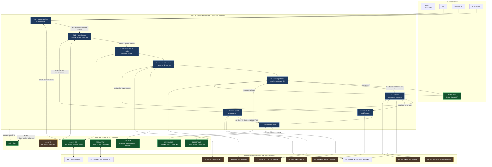
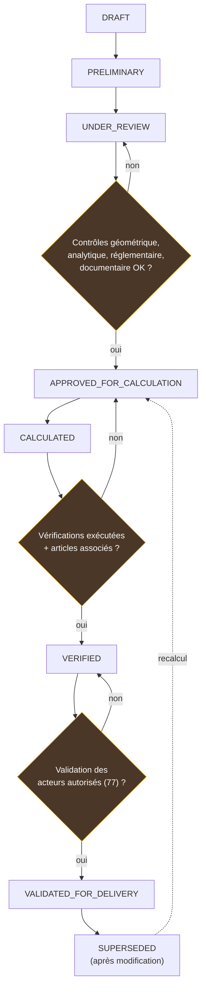

# STRUCTCALC PRO — Flowchart de projet global

> **Objet** : chaîne complète d'ingénierie, du dossier architectural au document
> validé, avec l'intégration du **MODULE 71 — Architectural-to-Structural
> Formwork Engine** (transformation architectural → modèle structurel → plans
> de coffrage).
>
> **Règles directrices (spec §0, §17, §20 et Module 71 §17)** :
> - aucun plan géométriquement cohérent n'est une structure sûre par défaut ;
> - aucune conformité n'est déclarée sans vérification (articles + ingénieur) ;
> - un plan de coffrage n'est **jamais** validé parce qu'il a été généré
>   automatiquement ;
> - aucune étape n'efface la responsabilité du BET, de l'architecte ou du
>   bureau de contrôle.

**Dernière mise à jour** : 2026-10-13
**Statut** : Module 71 = **implémenté** dans
`structcalc/architectural_structural/` (15 sous-modules + `model_ext`, tests +
vérification de bout en bout via `tools/verify_module71_pipeline.py`). Les
adaptateurs d'import Revit/IFC/DWG/PDF restent des squelettes honnêtes
(`ADAPTER_NOT_IMPLEMENTED`). Voir `docs/STATUS.md` pour l'état d'avancement
du code existant.

---

## 1. Chaîne complète (spec §17 + Module 71 §17)

```
DOSSIER ARCHITECTURAL
        │
        ▼
 [71.A] IMPORT BIM/CAD ──── Revit · IFC · DWG/DXF · PDF
        │                    (unités, échelles, doublons contrôlés)
        ▼
 MODÈLE INTERNE CANONIQUE (CORE · SC-*)
        │
        ▼
 [71.B] PROPOSITION STRUCTURELLE ── trame · poteaux · poutres · dalles
        │                            (variantes A·B·C·D, raisons tracées)
        ▼
 [71.C] MODÈLE STRUCTUREL CENTRAL ── géométrie ≠ analytique ≠ graphique
        │
        ▼
 [71.D] CONTINUITÉ VERTICALE + DESCENTE DE CHARGES (06_LOAD_TAKE_DOWN)
        │
        ▼
 [71.E] ROBOT (12_ROBOT_INTERFACE) ── export ▸ calcul ◂ import
        │
        ▼
 RÉSULTATS ── réactions · efforts · déplacements · modaux
        │
        ▼
 VÉRIFICATIONS (10_ANALYSIS_ENGINE + 25_REGULATION_REGISTRY)
        │        BAEL 91 r99 · RPS 2011 · statuts honnêtes
        ▼
 [71.F] COORDINATION / CONFLITS (59 · 66) ── architecture ⟷ structure
        │
        ▼
 [71.I] CORRECTIONS · CHANGEMENTS (67_CHANGE_IMPACT_ENGINE)
        │        (résultats périmés → invalidés)
        ├──────────────────► recalcul (boucle) ◄─────────────┐
        ▼                                                    │
 [71.G] PLANS DE COFFRAGE (70_DRAWING_ENGINE)                │
        │                                                    │
        ▼                                                    │
 FERRAILLAGE (à partir des calculs, séparé du coffrage)      │
        │                                                    │
        ▼                                                    │
 [71.J] CONTRÔLE QUALITÉ (59 + 77_ROLE_APPROVAL_ENGINE) ─────┘
        │              (géométrique · analytique · réglementaire · documentaire)
        ▼
 VALIDATION (acteurs autorisés) ──▶ DIFFUSION
```

**Boucle obligatoire** : toute modification (Module 71 §9/§12) fait **régresser**
les résultats et documents concernés vers `OUTDATED` jusqu'à recalcul/revalidation.

---

## 2. Flowchart global (vue logique)



**Légende** :
- 🟦 **bleu** = Module 71 (implémenté — `structcalc/architectural_structural/`)
- 🟩 **vert** = couches déjà implémentées et testées (voir `docs/STATUS.md`)
- 🟧 **orange** = modules complémentaires à venir

---

## 3. Dépendances du Module 71 (spec §1)

Le Module 71 **ne calcule ni ne valide seul** : il orchestre. Il coordonne :

| Module | Rôle dans la chaîne 71 | État code actuel |
|---|---|---|
| `00_CORE_MODEL` | modèle canonique `SC-*`, statuts, provenance | 🟩 `structcalc/core/` |
| `06_LOAD_TAKE_DOWN` | descente de charges, sans double comptage | 🟧 `solver/` (à faire) |
| `10_ANALYSIS_ENGINE` | vérifications de résistance/stabilité | 🟧 |
| `12_ROBOT_INTERFACE` | échange contrôlé avec Robot | 🟩 `integration/robot/` |
| `24_TRACEABILITY` | traçabilité des modifications | 🟩 `core/status.py`, `tracked.py` |
| `25_REGULATION_REGISTRY` | référentiels + statuts | 🟩 `regulation/` (articles non vérifiés) |
| `59_MODEL_VALIDATION_ENGINE` | contrôle avant calcul / avant diffusion | 🟧 (partiel : `verify_transfer`) |
| `60_DEPENDENCY_ENGINE` | propagation de dépendances | 🟧 |
| `66_BIM_COORDINATION_ENGINE` | coordination BIM | 🟧 |
| `67_CHANGE_IMPACT_ENGINE` | impact d'une modification | 🟧 |
| `70_DRAWING_ENGINE` | génération des plans | 🟧 |
| `77_ROLE_APPROVAL_ENGINE` | validation par acteurs autorisés | 🟧 |

> **Règle de séparation (Module 71 §14)** : les moteurs **géométriques**,
> **réglementaires**, **analytiques** et **documentaires** restent séparés ; les
> interfaces Revit/IFC/DWG/Robot sont abstraites pour que les règles métier ne
> dépendent d'aucun logiciel unique. → conforme à la règle de dépendance
> `CORE ne dépend ni de Qt, ni de COM` (audit Phase 0 §6).

---

## 4. Flowchart interne du Module 71 (Phases A → J)

```mermaid
flowchart LR
    subgraph PHASES["Module 71 — Phases"]
        direction LR
        PA["A · Import<br/>architectural"]
        PB["B · Proposition<br/>système porteur"]
        PC["C · Modèle<br/>structurel central"]
        PD["D · Continuité +<br/>descente de charges"]
        PE["E · Interface<br/>Robot"]
        PF["F · Moteur de<br/>conflits"]
        PG["G · Plans de<br/>coffrage"]
        PI["I · Impact des<br/>modifications"]
        PJ["J · Contrôle qualité<br/>+ validation"]
    end

    PA -->|"statuts : PROVIDED / ASSUMED / MISSING / CONFLICT"| PB
    PB -->|"variantes A·B·C·D + raisons"| PC
    PC -->|"géométrie ≠ analytique ≠ graphique"| PD
    PD -->|"charges + origines + combinaisons"| PE
    PE -->|"7 contrôles de retour (§8.3)"| PF
    PF -->|"cycle DETECTED → … → VALIDATED_FOR_DELIVERY"| PJ
    PF -->|"solution → variante → recalcul"| PI
    PI -->|"résultats marqués OUTDATED"| PD
    PJ -->|"APPROVED_FOR_CALCULATION"| PG
    PG -->|"cartouche · version · statut · sections provisoires"| PJ
    PJ -.->|"REJECTED / UNRESOLVED"| PB

    classDef phase fill:#1e3a5f,stroke:#89b4fa,color:#fff
    class PA,PB,PC,PD,PE,PF,PG,PI,PJ phase
```



---

## 5. Porte de validation (validation gates)

Aucun document ne passe une porte sans les contrôles requis (Module 71 §13).



> **Règle Module 71 §13** : « Un calcul terminé ne suffit pas à rendre un plan
> exécutable. » → `CALCULATED` **ne** préjuge **jamais** de la conformité ;
> seule `VALIDATED_FOR_DELIVERY` autorise la diffusion, et encore selon le
> processus du projet.

---

## 6. Projet de référence pédagogique (Module 71 §3, §11)

Utilisé pour les tests — **hypothèses pédagogiques, jamais prescriptions** :

| Paramètre | Valeur de test |
|---|---|
| Identifiant | `SC-TEST-R3-100M2` |
| Niveaux | RDC + 3 étages (4 niveaux) |
| Emprise | 10,00 × 10,00 m (100 m²/niveau, ~400 m² cumulé) |
| Trame | 3 axes × 3 axes, entraxe 5,00 m |
| Poteaux | 9 par niveau (positions initiales) |
| Dalles | 4 panneaux/niveau (avant trémies) |
| Hauteurs | RDC 3,50 m ; étages 3,00 m |
| Sous-sol | absent |
| Système | poteaux + poutres + dalles BA |

Le système doit aussi accepter **géométries irrégulières, niveaux différents,
poteaux décalés, voiles, ouvertures variables**.

---

## 7. Mapping Module 71 → code STRUCTCALC existant

Sous-modules cibles (spec Module 71 §14), package
`src/structcalc/architectural_structural/` — à adapter à l'arborescence
`structcalc/` actuelle :

| Sous-module | Responsabilité | Point d'ancrage existant |
|---|---|---|
| `architectural_import_service.py` | adaptateurs Revit/IFC/DWG/PDF | `integration/` (+ Revit fiche) |
| `geometry_normalization.py` | normalisation géométrique | `core/model.py` |
| `axis_grid_engine.py` | axes / trame | nouveau (`Axis`, `Level`) |
| `structural_layout_proposal.py` | proposition trame (variantes) | `solver/` + `scope/` |
| `vertical_continuity_checker.py` | continuité verticale | nouveau |
| `opening_reservation_checker.py` | ouvertures / trémies / gaines | nouveau (`Opening`) |
| `structural_model_builder.py` | modèle central → `SC-*` | 🟩 `core/model.py` |
| `load_transfer_linker.py` | liaison vers `06_LOAD_TAKE_DOWN` | `solver/` (à faire) |
| `conflict_detection_engine.py` | conflits archi–structure | nouveau (`Conflict`) |
| `design_variant_manager.py` | variantes + versions | `solver/column_design.py` (pattern) |
| `robot_exchange_coordinator.py` | export/import Robot contrôlé | 🟩 `integration/robot/` |
| `drawing_generation_coordinator.py` | plans → `70_DRAWING_ENGINE` | nouveau |
| `change_impact_dispatcher.py` | propagation dépendances → `67` | nouveau |
| `model_drawing_consistency_checker.py` | cohérence modèle ↔ plans | nouveau |
| `validation_gate.py` | portes de validation (§13) | 🟩 `core/status.py` |

> **Objets CORE à ajouter** (spec Module 71 §6.1) : `Building`, `Level`,
> `Axis`, `ArchitecturalElement`, `Opening`, `Stair`, `Wall`, `Slab`, `Beam`,
> `Foundation`, `LoadCase`, `LoadCombination`, `AnalysisModel`,
> `AnalysisResult`, `Conflict`, `DesignVariant`, `Drawing`, `Approval`,
> `Revision`. (Certains existent déjà partiellement : `Project`, `Node`,
> `Column`, `Material`, `CrossSection`, `ExternalRef`.)

---

## 8. Critères d'acceptation du Module 71 (spec §16)

1. importe/reçoit une géométrie architecturale exploitable ;
2. construit une représentation interne à identifiants stables ;
3. propose une trame structurelle ;
4. détecte incohérences géométriques et discontinuités ;
5. prépare un modèle de calcul cohérent ;
6. échange avec Robot selon les interfaces disponibles ;
7. associe correctement les résultats aux éléments ;
8. identifie les conflits et compare les variantes ;
9. génère des plans cohérents avec le modèle source ;
10. invalide résultats et documents affectés par une modification ;
11. conserve versions, preuves et validations ;
12. **interdit** de présenter comme définitif un document dont les contrôles
    obligatoires restent ouverts.

---

## 9. Voir aussi

- `docs/STATUS.md` — état d'avancement réel (PRUVÉ / EN COURS / NON IMPLÉMENTÉ)
- `docs/phase0/AUDIT_PHASE0.md` — schéma d'architecture en couches (§6) et
  règle de dépendance
- Spec Module 71 (document fourni par l'utilisateur) — spécification complète
